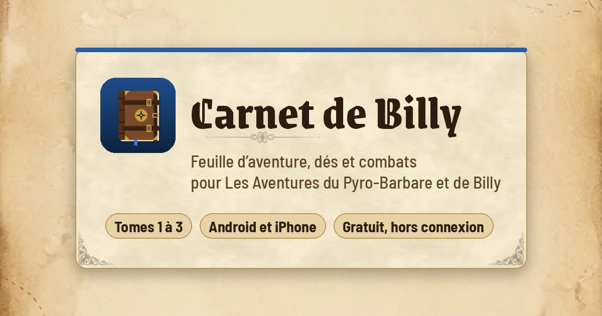

# Carnet de Billy : feuille d’aventure pour Les Aventures du Pyro-Barbare et de Billy

Application compagnon gratuite pour les livres-jeux *Les Aventures du Pyro-Barbare et de Billy* de Bob Lennon et David Kuhn : *La Forteresse du Chaudron Noir* (tome 1), *La Corne des Sables d’Ivoire* (tome 2) et *La Lance de Valkar* (tome 3). Elle remplace la feuille d’aventure : fiche de Billy, sac, dés, combats et notes. Le livre reste indispensable pour jouer : l’application ne contient aucun texte des livres.

## Télécharger

- **Android** : [télécharger l’application (APK)](https://github.com/Duchneu/carnet-de-billy/releases/latest/download/carnet-de-billy.apk)
- **iPhone, tablette ou ordinateur** : [ouvrir l’application dans le navigateur](https://duchneu.github.io/carnet-de-billy/)

## Installer sur Android

1. Depuis le téléphone, toucher le lien **télécharger l’application (APK)** ci-dessus.
2. Une fois le téléchargement terminé, ouvrir le fichier `carnet-de-billy.apk` (depuis la notification ou le dossier **Téléchargements**).
3. Si le téléphone bloque l’installation, toucher **Paramètres** puis activer **Autoriser depuis cette source** pour le navigateur, et revenir en arrière.
4. Si Google Play Protect affiche un avertissement, toucher **Plus de détails** puis **Installer quand même** : l’application n’est simplement pas distribuée sur le Play Store.
5. Toucher **Installer**, puis **Ouvrir**.

Android 7 ou plus récent. Pour mettre à jour, télécharger de nouveau l’APK avec le même lien et l’installer par-dessus : les parties sont conservées.

## Installer sur iPhone

1. Ouvrir le lien **ouvrir l’application dans le navigateur** dans **Safari**.
2. Toucher le bouton de partage, puis **Sur l’écran d’accueil**.
3. L’application apparaît avec son icône et fonctionne ensuite sans connexion.

## Fonctionnalités

- **Parties** : plusieurs aventures en parallèle, une par partie, pour *La Forteresse du Chaudron Noir*, *La Corne des Sables d’Ivoire* et *La Lance de Valkar*. Un autre tome peut être ajouté en saisissant sa page de création de Billy.
- **Création de Billy** : choix des trois objets de départ ; la classe et les caractéristiques se calculent seules, règle des deux mains comprise.
- **Fiche** : PV, Chance, caractéristiques avec le détail de leur calcul, compteurs de la feuille d’aventure, bonus propres à chaque tome.
- **Paragraphes** : paragraphe en cours, retour au précédent, historique et notes par paragraphe.
- **Combats** : table des situations, esquive, contre-attaque critique, domination, pouvoirs de classe et évolutions de caractère. Les combats des tomes 1 et 2 sont pré-remplis avec leurs règles spéciales. Un assaut peut être annulé.
- **Dés** : lancer libre, tests d’Adresse et de Chance.
- **Sac** : objets de départ et objets trouvés, avec leurs bonus.
- **Succès** : déblocage automatique en arrivant au paragraphe (tomes 1 et 2) ou saisie manuelle.
- **Sauvegardes** : points de sauvegarde nommés, export et import de copies de sécurité.
- Fonctionne hors connexion, en thème clair comme en thème sombre.

## Prise en main

1. **Mes parties** (icône des livres, en haut à gauche) → **Nouvelle partie** → choisir le tome.
2. Choisir trois objets de départ, puis **Créer Billy**.
3. Taper le numéro du paragraphe où l’on se trouve, puis **Aller**.
4. En combat : engager le combat proposé ou saisir l’adversaire depuis son encadré, puis **Lancer l’assaut**. L’icône d’édition, sous la barre de vie de Billy, permet d’ajuster les valeurs.
5. L’engrenage, en haut à droite, ouvre les réglages. Un tutoriel s’affiche au premier lancement et peut être revu depuis les réglages.

## Données

Tout reste sur l’appareil : rien n’est envoyé sur un serveur. Pour changer d’appareil, **Carnet → Copie de sécurité → Exporter**, puis **Importer** sur le nouvel appareil. Sur Android, un dossier de sauvegarde automatique peut être choisi dans le Carnet.

## Publication avec GitHub Pages

**Settings → Pages → Build and deployment** : source « Deploy from a branch », branche `main`, dossier `/ (root)`. L’application est alors disponible à l’adresse `https://<utilisateur>.github.io/<dépôt>/`.

## Avertissement

Projet de fan, non officiel, sans lien avec l’auteur ni l’éditeur des livres. *Les Aventures du Pyro-Barbare et de Billy* et leurs contenus appartiennent à leurs ayants droit.
